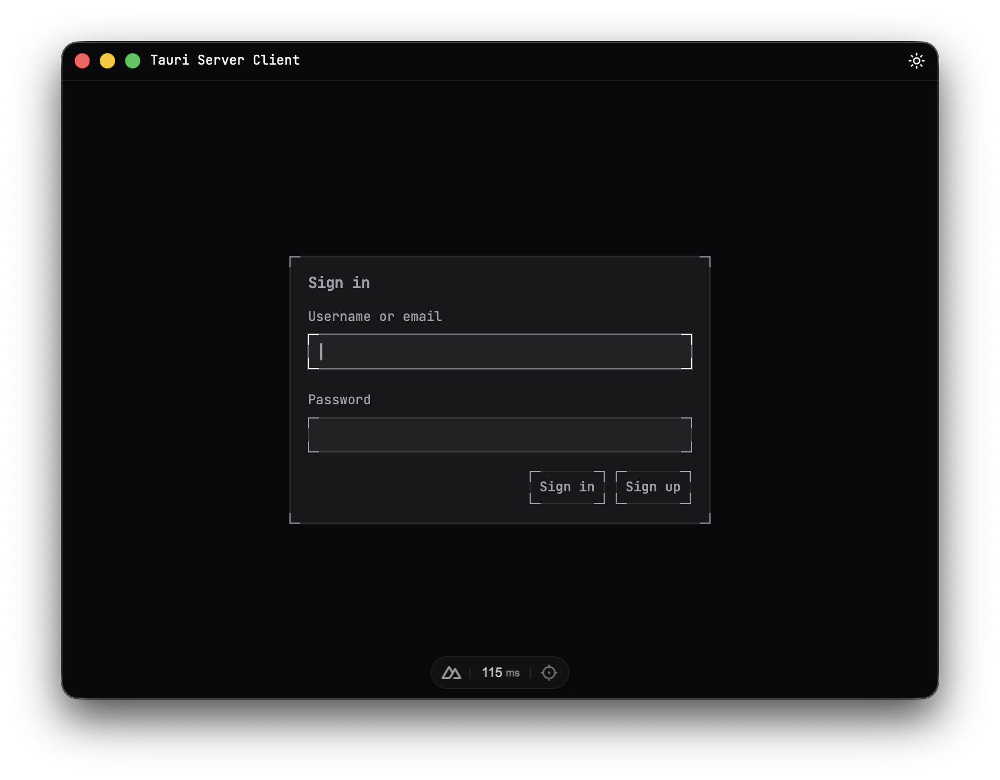
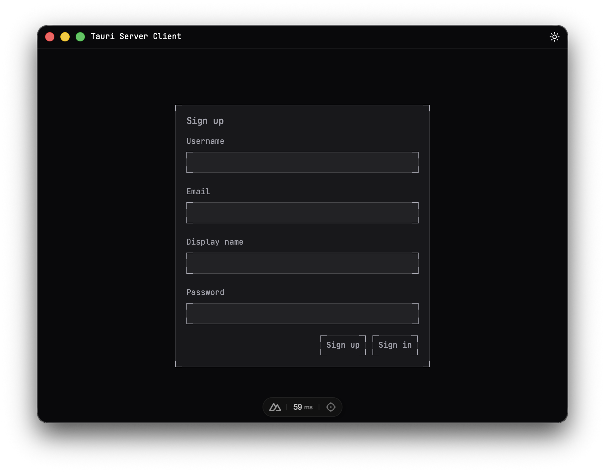
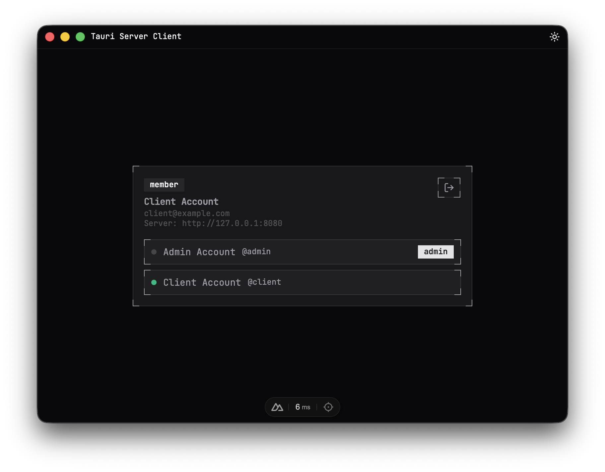
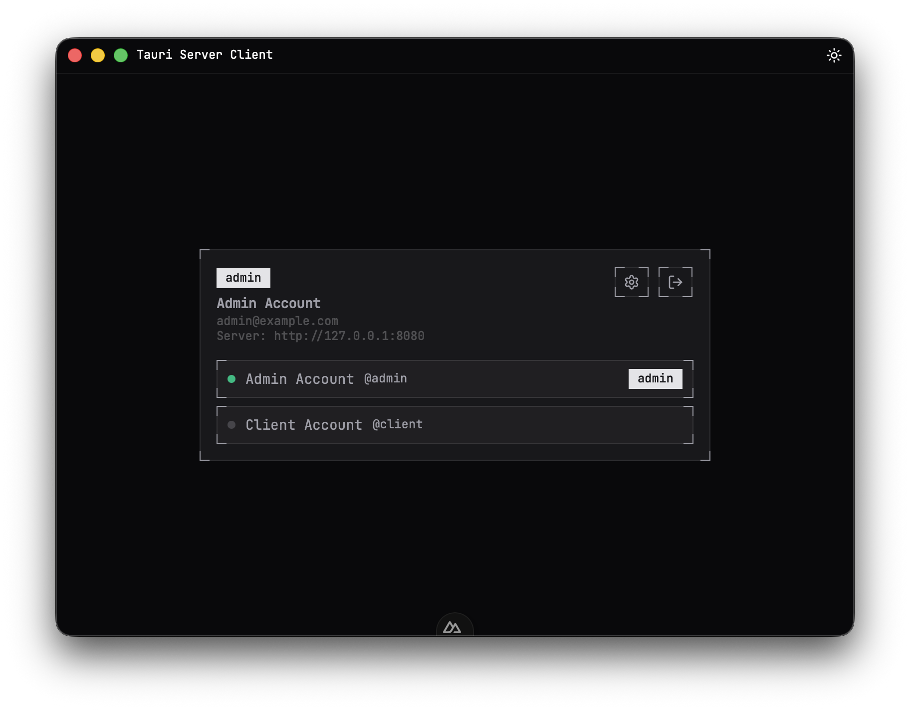
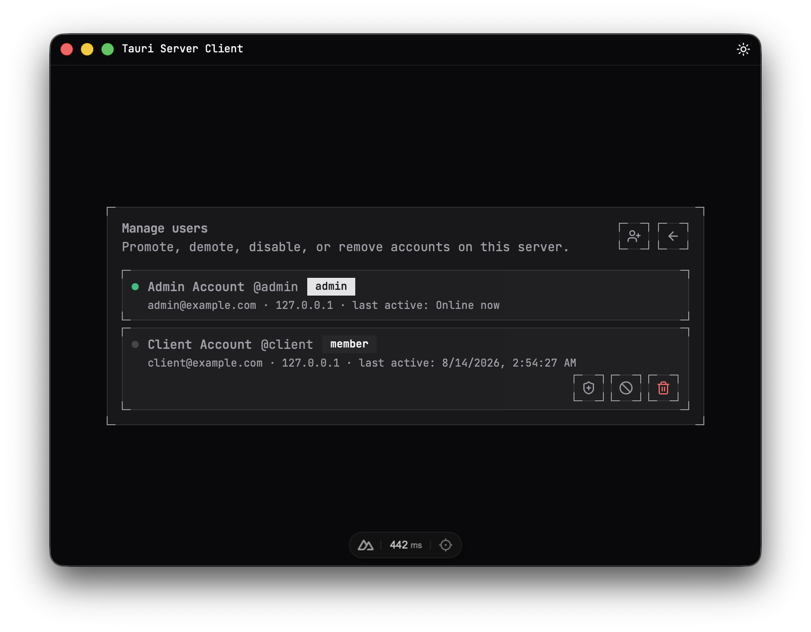
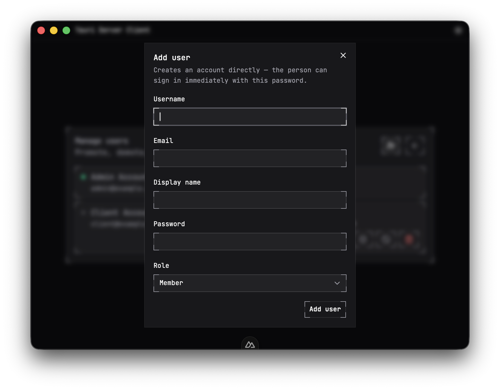

# Tauri Server Client

[](https://github.com/xcvzlabs/tauri-server-client/actions/workflows/ci.yaml)
[](https://github.com/xcvzlabs/tauri-server-client/actions/workflows/release.yaml)

A LAN-based client-server desktop application built with Tauri and Rust, with a Nuxt + Vue frontend. One person hosts a server on their machine, everyone else on the same network connects to it as a client — no internet or external infrastructure required.

## Screenshots

<table>
  <tr>
    <td align="center" width="50%">
      
      <br />
      Sign in
    </td>
    <td align="center" width="50%">
      
      <br />
      Sign up
    </td>
  </tr>
  <tr>
    <td align="center" width="50%">
      
      <br />
      Home — signed in as a member
    </td>
    <td align="center" width="50%">
      
      <br />
      Home — signed in as an admin
    </td>
  </tr>
  <tr>
    <td align="center" width="50%">
      
      <br />
      Admin — manage users
    </td>
    <td align="center" width="50%">
      
      <br />
      Admin — add a user directly
    </td>
  </tr>
</table>

## How it works

The app is a single desktop client that can act as either a host or a joiner:

1. **Welcome** — choose to host a new session or join one that's already running on the LAN.
2. **Host** spawns the `server` binary locally (bound to `0.0.0.0:8080`), points the client at `127.0.0.1:8080`, and takes you straight to sign up as the first (admin) user. The server process is killed automatically when the hosting window closes.
3. **Join** asks for a server address (e.g. `192.168.1.10:8080`) already running on someone else's machine, then takes you to sign in.
4. **Sign in / sign up** authenticates against the connected server (JWT-based). New accounts created via sign-up are regular members.
5. **Home** shows every account on the server with live online/offline presence over a WebSocket connection. Admins additionally see a settings shortcut into user management.
6. **Manage users** (admin only) — promote/demote, disable/enable, remove accounts, or add a new user directly with a chosen role and password.

Route access is enforced by `app/middleware/session.global.ts`: you can't reach authenticated pages without a connected server and a valid session, and you're redirected forward automatically once both are satisfied.

## Stack

- [Tauri v2](https://v2.tauri.app) (Rust) for the desktop shell
- [Nuxt 4](https://nuxt.com) + Vue 3 for the frontend
- [Axum](https://docs.rs/axum) + SQLite ([sqlx](https://docs.rs/sqlx)) for the LAN server (`server/`)
- [Bun](https://bun.sh) as the runtime and package manager
- [Valibot](https://valibot.dev) for validation
- [Vitest](https://vitest.dev) for tests
- [oxlint](https://oxc.rs) + [oxfmt](https://oxc.rs) for linting and formatting

## Project structure

```
app/            Nuxt frontend — pages, components, composables
server/         Standalone Axum REST + WebSocket API (see server/README.md)
src-tauri/      Tauri desktop shell (Rust) — window, hosting, IPC commands
scripts/        Dev server orchestration, versioning, and release automation
```

## Server

The `server/` directory is a standalone Axum REST + WebSocket API (JWT auth, SQLite storage, real-time user presence) that the Tauri app and Nuxt frontend talk to over the LAN. See [server/README.md](server/README.md) for setup, configuration, and the API reference.

## Desktop app

`src-tauri/` is the Tauri v2 shell around the Nuxt frontend. When you choose to host, `src-tauri/src/hosting.rs` spawns the `server` binary as a child process with a generated JWT secret and an app-data-scoped SQLite database, waits for it to start listening, and exposes `start_server`/`stop_server` commands to the frontend (`app/composables/useHosting.ts`). This currently expects the `server` binary to already be built alongside `src-tauri` on the same machine — run `bun run server:build` before hosting from a packaged app.

## Setup

Install dependencies:

```bash
bun install
```

## Development

Start the app in development mode (Nuxt dev server + Tauri window):

```bash
bun run dev
```

## Checks

```bash
bun run fmt:check   # oxfmt + cargo fmt --check
bun run lint        # oxlint + cargo clippy
bun run nuxt:typecheck
bun run test         # vitest
```

## Release

Version bumps, changelog generation, and Tauri version sync are handled by `scripts/release.ts`:

```bash
bun run release patch   # or minor / major
```

This bumps `package.json`, generates the changelog, syncs the version into `src-tauri/Cargo.toml`, `Cargo.lock`, and `tauri.conf.json`, then commits, tags, and pushes. The [release workflow](.github/workflows/release.yaml) picks up the pushed tag and builds/publishes the desktop app.

## License

[MIT](LICENSE)
